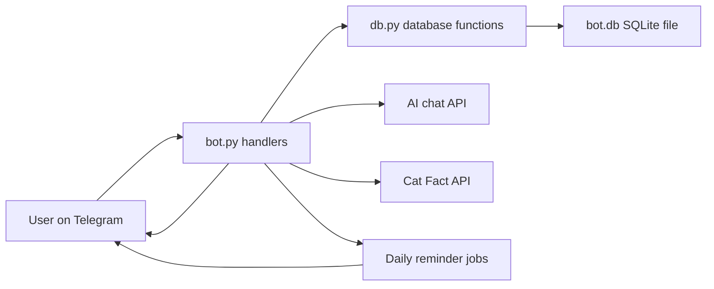

# Telegram Task, Reminder & AI Assistant Bot

A multi-user Telegram bot written in Python. It combines a personal to-do list with tap buttons, daily reminders, CSV export, and an AI chat assistant that remembers the conversation. Data is stored in a SQLite database, and the bot runs 24/7 on a cloud host (Wispbyte).

## Key Features

- **Personalized lists:** Each user has an isolated to-do list identified by their Telegram ID.
- **Task management:** Add tasks in one line or step by step (`/add` alone makes the bot ask for the task), mark them as DONE, and remove them. Duplicate tasks are rejected.
- **Tap buttons:** `/list` shows every open task with a done button and a delete button, so you can manage tasks without typing.
- **Progress tracking:** See how many tasks you finished and your completion percentage.
- **Scheduled reminders:** Daily reminder at a time you choose, with timezone support (`Africa/Algiers`). Reminders are restored automatically after a restart.
- **CSV export:** `/export` sends your tasks as a CSV file that opens in Excel.
- **AI assistant:** Ask a single question with `/ask <question>`, or send `/ask` alone to start a chat. In chat mode you just write normal messages, and the bot remembers the last 10 messages of the conversation.
- **Usage limit:** Each user gets a daily limit of AI messages (20 by default), so the free API quota is protected.
- **Public API example:** `/fact` fetches a random cat fact from a public API.
- **Built to be reliable:** Every API call has a timeout and error handling, and runs in a separate thread, so one slow AI answer never blocks other users.
- **Persistent storage:** Tasks, reminder settings and usage counters survive restarts in a SQLite database.

## Screenshots


## Available Commands

| Command | Description |
| :--- | :--- |
| `/start` | Welcome message and summary of available commands |
| `/add <task>` | Add a task to your TODO list. Use `/add` alone and the bot asks for the task |
| `/done <task>` | Mark an existing task as completed and move it to DONE |
| `/remove <task>` | Delete a task from either list |
| `/tasks` | Show your current TODO and DONE lists |
| `/list` | Show your TODO tasks with done and delete buttons |
| `/stats` | Show total tasks and your completion percentage |
| `/remind <HH:MM>` | Schedule a daily reminder (24-hour format) |
| `/export` | Receive your tasks as a CSV file |
| `/ask <question>` | Get one AI answer |
| `/ask` | Start AI chat mode with conversation memory |
| `/fact` | Get a random cat fact from a public API |

## How the AI Chat Works

1. `/ask` alone turns chat mode on for that user.
2. Each normal message is sent to the AI together with the last 10 messages, so follow-up questions make sense.
3. Chat mode ends automatically after 1 minute without messages, or as soon as the user sends any other command.
4. When the chat ends, the stored conversation is cleared.

## Architecture



The bot code (`bot.py`) decides what to reply, and all database work lives in `db.py`, so the commands never contain SQL.

## Database

SQLite is built into Python, so there is nothing extra to install. The file `bot.db` is created automatically on first start, with two tables:

- `tasks`: one row per task, with a permanent `id`, the `user_id`, the task text and its status (`todo` or `done`). The buttons use the permanent `id`, so they stay correct even when other tasks change.
- `users`: one row per user, with their reminder time and their daily AI usage counter.

All queries use parameter placeholders, and the buttons only act on tasks that belong to the user who tapped them.

## Tech Stack

- **Language:** Python 3.10+
- **Bot framework:** `python-telegram-bot` (with JobQueue support)
- **HTTP requests:** `requests`
- **AI provider:** NVIDIA NIM chat completions API (free tier, for prototyping)
- **Environment management:** `python-dotenv`
- **Timezone support:** `tzdata` / `zoneinfo`
- **Storage:** SQLite (`sqlite3`, part of the Python standard library)

## Getting Started

### 1. Clone the Repository
```bash
git clone https://github.com/Stephanie0i/telegram-task-reminder-bot.git
cd telegram-task-reminder-bot
```

### 2. Set Up Virtual Environment & Dependencies
```bash
python -m venv .venv
# Windows:
.venv\Scripts\activate
# Linux / macOS:
source .venv/bin/activate

pip install -r requirements.txt
```

### 3. Configure Secrets
Create a `.env` file in the root directory (see `.env.example`):
```env
TOKEN=your_bot_token_from_botfather
NVIDIA_API_KEY=your_api_key_from_build.nvidia.com
```

> **Security Note:** Never commit your `.env` file, bot token, API keys or your `bot.db` database to version control. They are listed in `.gitignore`.

### 4. Run the Bot
```bash
python bot.py
```

## Configuration

The settings are constants at the top of `bot.py`:

- `MODEL`: the model name used for answers
- `URL`: the chat completions endpoint
- `SYSTEM_PROMPT`: the instructions that define the assistant's behavior
- `DAILY_LIMIT`: how many AI messages each user can send per day

To try another provider that uses the same chat completions format, change `URL`, `MODEL`, and the API key variable.

## Deployment Notes

This bot runs continuously on a cloud host (such as Wispbyte, a VPS, or a container):
1. Upload `bot.py`, `db.py` and `requirements.txt`.
2. Set `TOKEN` and `NVIDIA_API_KEY` securely as environment variables or secrets.
3. Start `bot.py` as a background worker or managed service. The database file is created on first start.

## Known Limitations & Roadmap

- The NVIDIA free tier is rate limited and meant for prototyping, so do not send private data through it.
- AI answers are capped at 200 tokens to keep them short and fast.
- Chat mode state is kept in memory, so it resets when the bot restarts.
- The reminder timezone is fixed to `Africa/Algiers`.
- SQLite is a single file, which is a good fit for small and medium bots. A client-server database would be the next step for large scale.
- Planned: a custom system prompt for specialized assistants, and more automation commands.

## Project Structure

- `bot.py`: the bot (commands, AI helper, API helpers, reminders)
- `db.py`: all database functions
- `requirements.txt`: Python dependencies
- `bot.db`: created automatically to store user data (not committed)
- `.env`: your secrets (not committed)
