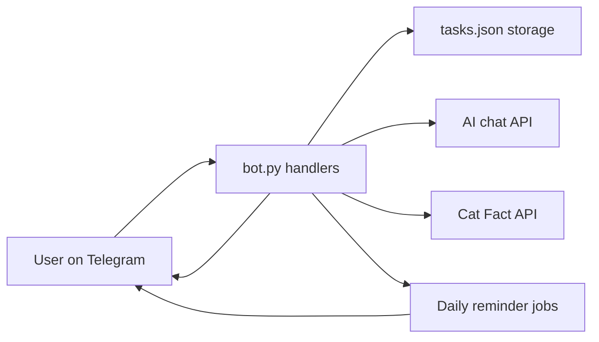

# Telegram Task, Reminder & AI Assistant Bot

A multi-user Telegram bot written in Python. It combines a personal to-do list, daily reminders, and an AI chat assistant that remembers the conversation. It runs 24/7 on a cloud host (Wispbyte).

## Key Features

- **Personalized lists:** Each user has an isolated to-do list identified by their Telegram ID.
- **Task management:** Add tasks in one line or step by step (`/add` alone makes the bot ask for the task), mark them as DONE, and remove them. Duplicate tasks are rejected.
- **Progress tracking:** See how many tasks you finished and your completion percentage.
- **Scheduled reminders:** Daily reminder at a time you choose, with timezone support (`Africa/Algiers`).
- **AI assistant:** Ask a single question with `/ask <question>`, or send `/ask` alone to start a chat. In chat mode you just write normal messages, and the bot remembers the last 10 messages of the conversation.
- **Public API example:** `/fact` fetches a random cat fact from a public API.
- **Built to be reliable:** Every API call has a timeout and error handling, and runs in a separate thread, so one slow AI answer never blocks other users.
- **Persistent storage:** Tasks and reminder settings survive restarts in a JSON file.

## Screenshots


## Available Commands

| Command | Description |
| :--- | :--- |
| `/start` | Welcome message and summary of available commands |
| `/add <task>` | Add a task to your TODO list. Use `/add` alone and the bot asks for the task |
| `/done <task>` | Mark an existing task as completed and move it to DONE |
| `/remove <task>` | Delete a task from either list |
| `/tasks` | Show your current TODO and DONE lists |
| `/stats` | Show total tasks and your completion percentage |
| `/remind <HH:MM>` | Schedule a daily reminder (24-hour format) |
| `/ask <question>` | Get one AI answer |
| `/ask` | Start AI chat mode with conversation memory |
| `/fact` | Get a random cat fact from a public API |

## How the AI Chat Works

1. `/ask` alone turns chat mode on for that user.
2. Each normal message is sent to the AI together with the last 10 messages, so follow-up questions make sense.
3. Chat mode ends automatically after 1 minute without messages, or as soon as the user sends any other command.
4. When the chat ends, the stored conversation is cleared.

## Architecture



## Tech Stack

- **Language:** Python 3.10+
- **Bot framework:** `python-telegram-bot` (with JobQueue support)
- **HTTP requests:** `requests`
- **AI provider:** NVIDIA NIM chat completions API (free tier, for prototyping)
- **Environment management:** `python-dotenv`
- **Timezone support:** `tzdata` / `zoneinfo`
- **Storage:** JSON file

## Getting Started

### 1. Clone the Repository
```bash
git clone https://github.com/Stephanie0i/telegram-task-reminder-bot.git
cd telegram-task-reminder-bot
```

### 2. Set Up Virtual Environment & Dependencies
```bash
python -m venv .venv
# Windows:
.venv\Scripts\activate
# Linux / macOS:
source .venv/bin/activate

pip install -r requirements.txt
```

### 3. Configure Secrets
Create a `.env` file in the root directory (see `.env.example`):
```env
TOKEN=your_bot_token_from_botfather
NVIDIA_API_KEY=your_api_key_from_build.nvidia.com
```

> **Security Note:** Never commit your `.env` file, bot token, or API keys to version control. Add `.env` and `tasks.json` to `.gitignore`.

### 4. Run the Bot
```bash
python bot.py
```

## Configuration

The AI settings are constants at the top of `bot.py`:

- `MODEL`: the model name used for answers
- `URL`: the chat completions endpoint
- `SYSTEM_PROMPT`: the instructions that define the assistant's behavior

To try another provider that uses the same chat completions format, change `URL`, `MODEL`, and the API key variable.

## Deployment Notes

This bot runs continuously on a cloud host (such as Wispbyte, a VPS, or a container):
1. Upload `bot.py` and `requirements.txt`.
2. Set `TOKEN` and `NVIDIA_API_KEY` securely as environment variables or secrets.
3. Start `bot.py` as a background worker or managed service.

## Known Limitations & Roadmap

- The NVIDIA free tier is rate limited and meant for prototyping, so do not send private data through it.
- AI answers are capped at 200 tokens to keep them short and fast.
- Chat mode state is kept in memory, so it resets when the bot restarts.
- The JSON file is fine for a small number of users. A database would be the next step for scale.
- Planned: a per-user limit on AI messages, CSV export of tasks, and a custom system prompt for specialized assistants.

## Project Structure

- `bot.py`: the whole bot (commands, AI helper, API helpers, reminders)
- `requirements.txt`: Python dependencies
- `tasks.json`: created automatically to store user data (not committed)
- `.env`: your secrets (not committed)
